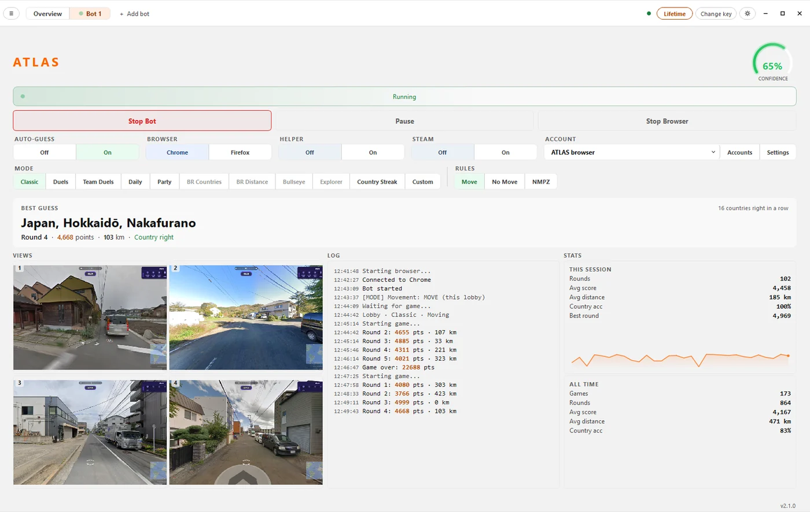

# GeoGuessr Cheat, Hack and Auto Guess Bot: ATLAS

  

  <b>An AI GeoGuessr cheat that reads the street view off your screen and names the location in about three seconds.</b> 
  Auto guess for Classic, Duels, Team Duels, Country Streak, the Daily and any community map, across Move, No Move and NMPZ. About 81 percent correct country in real ranked games, 111 countries. 
  <b>One key, every platform:</b> Windows, Steam, Chrome, Firefox, macOS, iPhone and Android.

  
  
  
  
  
  
  

  <a href="https://geoguessrcheats.com"><b>Get started</b></a> &middot;
  <a href="https://geoguessrcheats.com/plans">Plans from 14.99 euro</a> &middot;
  <a href="https://chromewebstore.google.com/detail/geoguesser-cheats-geogues/mggpkondmigmgbgafalghhkagkldinkj">7 free rounds in Chrome</a> &middot;
  <a href="https://geoguessrcheats.com/reviews">Reviews</a> &middot;
  <a href="https://discord.gg/zwYXRgRRHc">Discord</a>

ATLAS looks at the street view you are already looking at, works out where in the
world it is, and puts the pin there. On Windows it goes further and plays entire
sessions on its own, with more than one bot at a time in a single window. One
licence key covers every place it runs: the Windows app, the browser extension in
Chrome and Firefox, and the iPhone and Android apps.

Watch a full session:

## Guides on the site

- [How to cheat in GeoGuessr, every way](https://geoguessrcheats.com/how-to-cheat-in-geoguessr)
- [GeoGuessr hack: the AI location finder](https://geoguessrcheats.com/geoguessr-hack)
- [GeoGuessr Steam cheat: the full guide](https://geoguessrcheats.com/geoguessr-steam-cheat)
- [WorldGuessr cheat](https://geoguessrcheats.com/worldguessr-cheat)

---

## Contents

- [What ATLAS actually does](#what-atlas-actually-does)
- [One key, five places to use it](#one-key-five-places-to-use-it)
- [A round, from start to pin](#a-round-from-start-to-pin)
- [Every platform has its own page](#every-platform-has-its-own-page)
- [How it got here: v1.0 to V2.1](#how-it-got-here-v10-to-v21)
- [Numbers we publish](#numbers-we-publish)
- [What it costs](#what-it-costs)
- [Two free userscripts, no key needed](#two-free-userscripts-no-key-needed)
- [Questions people ask before buying](#questions-people-ask-before-buying)
- [Links](#links)

---

## What ATLAS actually does

You are in a round. Somewhere there is a road, a signpost, a kerb, a tree line, a
number plate. ATLAS reads that picture and answers the question the game is
asking: which country, and roughly where inside it.

Three things follow from that, and which of them you get depends on where you run
it:

**It tells you.** The country, the region or town, and the coordinates appear
while the round is still open, so you can decide what to do with them.

**It places the guess.** Instead of you dragging the map around, the pin lands on
the spot it worked out.

**It plays.** On Windows only, it starts the game, plays the round, submits,
takes the next one, and keeps going. You can leave the desk.

What it does not do is go hunting for clues. The answer comes from the spot where
the round starts, and ATLAS never travels down the road looking for a sign to
improve it.

## One key, five places to use it

This is the honest table, including the boxes we cannot tick.

| | Windows app | Chrome | Firefox | iPhone app | Android app |
|---|---|---|---|---|---|
| Works out where you are | Yes | Yes | Yes | Yes | Yes |
| Drops the pin on the map for you | Yes | Yes | Yes | Yes | Yes |
| Presses Guess for you | Yes | Yes | No | Yes | Yes |
| Starts games and plays session after session | Yes | No | No | No | No |
| Several bots at once, each on its own account | Yes, 2 or 4 | No | No | No | No |
| GeoGuessr on Steam | Yes | No | No | No | No |
| Free rounds before you buy | No | 7 | 7 | No | No |
| Also runs on macOS | No | Yes | Yes | No | No |
| Uses the same licence key | Yes | Yes | Yes | Yes | Yes |

Buy once, use it wherever you happen to be playing. The key is not tied to one of
these.

## A round, from start to pin

1. The round opens and the street view loads.
2. ATLAS reads the view from where the round starts. The Windows app takes four
   views around that spot.
3. It works out the country first, then narrows down inside it.
4. You get a country, a region or town, a direction, and coordinates.
5. The pin goes on the map, and on every platform except Firefox it can press
   Guess as well.
6. On Windows it takes the next round by itself and repeats until you stop it. A
   planned stop lets the game in progress finish first.

Most rounds are answered in under three seconds.

## Every platform has its own page

Each of these has its own repository, because each one behaves differently enough
to deserve a straight answer rather than a footnote.

| Platform | Repository | The short version |
|---|---|---|
| Windows | [atlas-geoguessr-windows-app](https://github.com/Sven233333/atlas-geoguessr-windows-app) | The only one that plays unattended, several bots at once |
| Steam | [atlas-geoguessr-steam](https://github.com/Sven233333/atlas-geoguessr-steam) | The Steam client, driven by the Windows app |
| Chrome | [atlas-geoguessr-chrome-extension](https://github.com/Sven233333/atlas-geoguessr-chrome-extension) | Seven rounds free, nothing to install on your system |
| Firefox | [atlas-geoguessr-firefox-addon](https://github.com/Sven233333/atlas-geoguessr-firefox-addon) | Same panel, one missing button |
| macOS | [atlas-geoguessr-macos](https://github.com/Sven233333/atlas-geoguessr-macos) | Extension yes, desktop bot no |
| iPhone and iPad | [atlas-geoguessr-ios](https://github.com/Sven233333/atlas-geoguessr-ios) | On the phone, new in v1.7 |
| Android | [atlas-geoguessr-android](https://github.com/Sven233333/atlas-geoguessr-android) | On the phone, new in v1.7 |

## How it got here: v1.0 to V2.1

The full list with every entry lives at
[geoguessrcheats.com/changelog](https://geoguessrcheats.com/changelog). This is
the shape of it.

**v1.0, the open beta.** Country and coordinates straight from the street view,
most rounds done in a few seconds, and auto play that placed the guess and moved
on. Classic games, the World map and most country maps.

**v1.1, stability.** Crash and error page recovery so an overnight session did not
need a human to restart it, plus wider geographic coverage.

**v1.2, the training tools.** An ELO tracker, a weakness map that shows where you
personally lose points, scheduled sessions, multi monitor support and faster NMPZ
rounds.

**v1.3, speed and reach.** Up to ten times faster predictions, GPU support for
cards with 8 GB, the interface translated to English, engine tuning in settings,
and the lifetime plan.

**v1.4, the plumbing.** Sign in with Google, Discord, GitHub or Twitch. Crypto and
PayPal payment options. Better duels play. Another 80 percent off analysis time.

**v1.5, half the size.** The download went from around 7.5 GB to under 4 GB.
Updates install themselves and every one is signature checked. Scoring moved
server side, so it keeps working on a slow connection, and the bot stopped giving
up mid session: it now makes a guess every round.

**v1.6, more than one screen.** The Steam edition became playable on its own. The
Bot Scheduler plans a full week of modes on a seven day grid. New interface with
twenty themes and per game history. The map is scanned with real mouse movement
before the pin drops.

**v1.7, the phone.** The extension arrived on Firefox, the panel started working
on an iPhone and on Android, you can switch browsers without reinstalling, and
the bot stopped throwing away rounds it never had to lose.

**v1.8, you play, it helps.** Helper mode: ATLAS never moves the camera or picks a
mode, it guesses when you ask. Six rebindable keys inside the game window, and
the guess names the state or province and the district under the country. NMPZ
stopped playing every round twice.

**v1.9, more to play and less waiting.** Country Streak, and Custom, where you
paste a community map's address and the bot plays that map. Shorter rounds, Duels
working again after GeoGuessr rebuilt its lobby, and Game History that opens any
round you played with the four views, the guess and the real location. The point
releases up to 1.9.5 made signing in work without Chrome and kept the bot going
after GeoGuessr's own updates.

**V2, several bots in one window (24 October 2026).** The Windows app runs more
than one bot at a time: two on Pro and Yearly, four on Lifetime. Each bot has a
GeoGuessr account you sign in once and that stays signed in, with a proxy of its
own if you want one. Two of your bots can play Team Duels as one team, or you can
host a party with your own bots in it. Stats and History cover every bot, with
personal records, and a recap card sums up each session. Settings save
themselves, you can sign in through the browser instead of pasting a key, and an
expired key offers Renew right in the app.

**The extension, 1.7.** A redrawn panel in light and dark, a dot that marks the
answer on GeoGuessr's own map when Auto Place is off, a Profile tab with your own
GeoGuessr numbers, and History game by game. Version 1.7.1 is the one in the
stores now.

**V2.1, calmer and quicker (6 November 2026).** The overview and every bot's page
were redrawn, with the tabs moved into the title bar. Photos are scored while the
bot is still looking around, which made solo rounds up to 25 percent faster;
Duels hardly changed. A shield over the bot's window takes your own mouse while
it plays, so a stray click cannot nudge it mid round. A planned stop lets the
running game finish, and a key you change in the app stays changed.

V2.2 is due on 21 November 2026.

## Numbers we publish

Only these, because a few figures we can stand behind beat ten we cannot.

- **81 percent** country accuracy in real games, not in a laboratory set.
- **111 countries** covered.
- Average score near **4,000** per round in the sessions behind that figure.

The reasoning behind those numbers, and what a fair comparison with other tools
looks like, is written up at
[geoguessrcheats.com/blog/geoguessr-ai-accuracy](https://geoguessrcheats.com/blog/geoguessr-ai-accuracy/).

## What it costs

| Plan | Price | Notes |
|---|---|---|
| Pro | 14.99 euro for 30 days | One payment, two bots at once in the Windows app |
| Yearly | 33.50 euro per year | Works out to 2.79 euro per month, no machine lock |
| Lifetime | 50.00 euro once | Four bots at once, six devices, early access to new features |

Nothing renews on its own. You can pay with crypto, gift cards, CS2 skins, or card
and PayPal through G2G, and a refund is possible within seven days if ATLAS will
not run on your PC and we cannot fix it. Full detail:
[geoguessrcheats.com/plans](https://geoguessrcheats.com/plans).

If you want to try before any of that, the Chrome and Firefox extensions give you
seven rounds without an account.

## Two free userscripts, no key needed

Both are MIT licensed, both are in [userscripts/](userscripts/), and neither has
anything to do with the paid product.

**GeoGuessr Round Journal.** Keeps a training journal of rounds you have already
finished: the real location, your guess, the distance, the score, a street view
link, and CSV or JSON export. It shows nothing during a round on purpose.

**GeoGuessr Round Timer.** A timer for your own rounds, for people who are trying
to get faster rather than more accurate.

## Questions people ask before buying

**Is there a free version of ATLAS?**
The browser extension gives you seven rounds free, with no account and no
download. The Windows app and the phone apps need a key.

**Does it work on a Mac?**
The extension does, in Firefox or Chrome, on the same key. The unattended bot
does not: there is no Mac build of the desktop app. See
[atlas-geoguessr-macos](https://github.com/Sven233333/atlas-geoguessr-macos).

**Does it work on GeoGuessr on Steam?**
Yes, through the Windows app, in all three movement rulesets. Windows only,
because the Steam edition has no Mac build.

**Can it play NMPZ?**
Yes. Classic, Duels, Team Duels, a party of your own, Country Streak and the Daily, in Move, No Move and NMPZ. Paste a community map's address and it plays that one instead of the world.

**Can I run more than one bot?**
Yes, in the Windows app since V2. Pro and Yearly run two at once and Lifetime
four, each signed in to its own GeoGuessr account.

**Does it need a fast computer?**
No. Since v1.5 the heavy part runs on our side, which is also why it keeps
working on a slow connection.

**Do I have to install anything to try it?**
No. The extension runs in the browser you already have.

**Is my subscription going to renew without asking?**
No. Nothing renews on its own.

**Which one should I start with?**
If you want to watch it work, the extension. If you want it to play for you while
you do something else, the Windows app.

## Links

- Website: <https://geoguessrcheats.com>
- All platforms: <https://geoguessrcheats.com/platforms>
- Plans and pricing: <https://geoguessrcheats.com/plans>
- Frequently asked questions: <https://geoguessrcheats.com/faq>
- What players say: <https://geoguessrcheats.com/reviews>
- Blog and release notes: <https://geoguessrcheats.com/blog>
- Discord: <https://discord.gg/zwYXRgRRHc>

## Disclaimer

ATLAS is an independent project. It is not affiliated with, endorsed by, or
connected to GeoGuessr AB or any of the other games it can read. Using an
assistant may be against the rules of a given game or competition. Check those
rules and decide for yourself where you use it. The userscripts in this
repository are separate from the paid product and are published under the MIT
licence.
